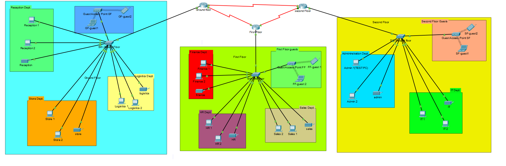

# Cisco_projects


# Vic Modern Hotel Network --- End-Year Networking Project

## 📅 Project Overview

### 🎯 Project Objectives

This project documents the original Cisco Packet Tracer configuration
for Vic Modern Hotel, a three-floor hotel. Each floor has a router and
access switch. Department networks are separated into VLANs, routers
exchange routes through OSPF, and end devices receive addresses
dynamically from the router serving their floor.

**This README intentionally matches the supplied original
configurations.** In particular, `SF-switch Fa0/1` is assigned to VLAN
20 (Admin) and has sticky port security enabled. The actual device whose
MAC address is learned depends on what is physically connected to that
port.

------------------------------------------------------------------------

## 🧰 Devices Used

-   **Routers:** `GF-Router`, `FF-Router`, `SF-Router` (Cisco 2911)
-   **Switches:** `GF-Switch`, `FF-Switch`, `SF-switch` (Cisco 2960 or
    equivalent)
-   **End devices:** Department PCs, laptops, printers, Wi-Fi clients,
    and the PC used to test SSH remote login
-   **Wireless devices:** Access points for each floor
-   **Cabling:** Ethernet cables for router-to-switch and end-device
    connections; serial DCE/DTE cables between routers

------------------------------------------------------------------------

## 🏢 Floor and Department Layout

  -----------------------------------------------------------------------
  Floor             Router            Switch            Departments
  ----------------- ----------------- ----------------- -----------------
  First floor       `GF-Router`       `GF-Switch`       Reception, Store,
                                                        Logistics

  Second floor      `FF-Router`       `FF-Switch`       Finance, HR,
                                                        Sales/Marketing

  Third floor       `SF-Router`       `SF-switch`       Admin, IT
  -----------------------------------------------------------------------

All three routers are placed in the IT server room. Each floor router
provides inter-VLAN routing and DHCP for the networks configured on that
floor.

------------------------------------------------------------------------

## 🌐 Task 1 --- IP Addressing and VLAN Plan

### Department VLANs

  Floor    Department          VLAN Network            Default Gateway
  -------- ----------------- ------ ------------------ -----------------
  First    Reception             80 `192.168.8.0/24`   `192.168.8.1`
  First    Store                 70 `192.168.7.0/24`   `192.168.7.1`
  First    Logistics             60 `192.168.6.0/24`   `192.168.6.1`
  Second   Finance               50 `192.168.5.0/24`   `192.168.5.1`
  Second   HR                    40 `192.168.4.0/24`   `192.168.4.1`
  Second   Sales/Marketing       30 `192.168.3.0/24`   `192.168.3.1`
  Third    Admin                 20 `192.168.2.0/24`   `192.168.2.1`
  Third    IT                    10 `192.168.1.0/24`   `192.168.1.1`

### Guest Wi-Fi VLANs in the original configurations

  Floor      VLAN Network             Default Gateway
  -------- ------ ------------------- -----------------
  First        90 `192.168.90.0/24`   `192.168.90.1`
  Second       91 `192.168.91.0/24`   `192.168.91.1`
  Third        92 `192.168.92.0/24`   `192.168.92.1`

These guest VLANs appear in the original router and switch
configurations in addition to the eight department VLANs.

### Serial links between routers

  ------------------------------------------------------------------------
  Link              Network           First endpoint    Second endpoint
  ----------------- ----------------- ----------------- ------------------
  GF ↔ FF           `10.10.10.0/30`   GF `S0/3/0` ---   FF `S0/3/0` ---
                                      `10.10.10.1/30`   `10.10.10.2/30`

  FF ↔ SF           `10.10.10.4/30`   FF `S0/3/1` ---   SF `S0/3/0` ---
                                      `10.10.10.5/30`   `10.10.10.6/30`

  SF ↔ GF           `10.10.10.8/30`   SF `S0/3/1` ---   GF `S0/3/1` ---
                                      `10.10.10.9/30`   `10.10.10.10/30`
  ------------------------------------------------------------------------

Each `/30` subnet provides two usable IP addresses for its
point-to-point serial link.

------------------------------------------------------------------------

## 🔌 Task 2 --- Physical Topology and Connections

Connect the network as follows:

1.  `GF-Router G0/0` to `GF-Switch G0/1`.
2.  `FF-Router G0/0` to `FF-Switch G0/1`.
3.  `SF-Router G0/0` to `SF-switch G0/1`.
4.  `GF-Router S0/3/0` to `FF-Router S0/3/0`.
5.  `FF-Router S0/3/1` to `SF-Router S0/3/0`.
6.  `SF-Router S0/3/1` to `GF-Router S0/3/1`.
7.  Connect department PCs and printers to access ports assigned to
    their department VLANs.
8.  Connect each floor's wireless access point to the intended switch
    port and configure wireless clients for DHCP.

The router-to-switch Ethernet links must be trunks because the routers
use 802.1Q subinterfaces for inter-VLAN routing.

**Serial clocking:** The original configurations apply
`clock rate 64000` to GF `S0/3/0`, GF `S0/3/1`, and FF `S0/3/1`. Clock
rate should be configured only on the DCE end of each serial link;
verify the actual DCE ends in Packet Tracer.

------------------------------------------------------------------------

## ⚙️ Task 3 --- Router Configuration Summary

### `GF-Router` --- First Floor

The original configuration contains:

-   Subinterfaces for VLANs 60, 70, and 80, plus guest VLAN 90.
-   Gateways `192.168.6.1`, `192.168.7.1`, `192.168.8.1`, and
    `192.168.90.1`.
-   DHCP pools `LOGISTICS`, `STORE`, `RECEPTION`, and `GUEST-GF`.
-   Serial addresses `10.10.10.1/30` and `10.10.10.10/30`.
-   OSPF process 1 with router ID `1.1.1.1`.
-   SSH version 2, domain name `vicmodernhotel.com`, and local user
    `admin`.

### `FF-Router` --- Second Floor

The original configuration contains:

-   Subinterfaces for VLANs 30, 40, and 50, plus guest VLAN 91.
-   Gateways `192.168.3.1`, `192.168.4.1`, `192.168.5.1`, and
    `192.168.91.1`.
-   DHCP pools `SALES`, `HR`, `FINANCE`, and `GUEST-FF`.
-   Serial addresses `10.10.10.2/30` and `10.10.10.5/30`.
-   OSPF process 1 with router ID `2.2.2.2`.
-   SSH version 2, domain name `vicmodernhotel.com`, and local user
    `admin`.

The original OSPF configuration also contains the broad statement
`network 10.10.10.0 0.0.0.255 area 0` in addition to specific serial
network statements. This README preserves that original detail.

### `SF-Router` --- Third Floor

The original configuration contains:

-   Subinterfaces for VLANs 10 and 20, plus guest VLAN 92.
-   Gateways `192.168.1.1`, `192.168.2.1`, and `192.168.92.1`.
-   DHCP pools `IT`, `ADMIN`, and `GUEST-SF`.
-   Serial addresses `10.10.10.6/30` and `10.10.10.9/30`.
-   OSPF process 1 with router ID `3.3.3.3`.
-   SSH version 2, domain name `vicmodernhotel.com`, and local user
    `admin`.

### Router-on-a-stick

The routers use 802.1Q subinterfaces on `G0/0`. For example, the
original `SF-Router` configuration includes:

``` cisco
interface GigabitEthernet0/0
 no ip address
!
interface GigabitEthernet0/0.10
 encapsulation dot1Q 10
 ip address 192.168.1.1 255.255.255.0
!
interface GigabitEthernet0/0.20
 encapsulation dot1Q 20
 ip address 192.168.2.1 255.255.255.0
```

Each subinterface is the default gateway for its VLAN.

### DHCP

Each router serves DHCP addresses to the VLANs configured for its floor.
Pools specify the relevant `/24` network, default gateway, and DNS
server `8.8.8.8`. The original configurations exclude the gateway
addresses from DHCP assignment.

### OSPF

All three routers use OSPF process 1 in area 0. OSPF advertises the
department networks and serial transit networks so that devices on
different floors can communicate.

### SSH

The original router configurations include:

``` cisco
ip ssh version 2
ip domain-name vicmodernhotel.com
!
line vty 0 4
 login local
 transport input ssh
```

Each router also has a local `admin` user. Successful SSH operation
should be confirmed by logging in from the test PC.

------------------------------------------------------------------------

## 🔀 Task 4 --- Switch VLAN and Port Assignments

### `GF-Switch` --- First Floor

  Switch ports       VLAN Department / purpose
  --------------- ------- -----------------------
  `Fa0/1–Fa0/3`        80 Reception
  `Fa0/4–Fa0/6`        70 Store
  `Fa0/7–Fa0/9`        60 Logistics
  `Fa0/10`             90 Guest network
  `Gi0/1`           Trunk Uplink to `GF-Router`

### `FF-Switch` --- Second Floor

  Switch ports       VLAN Department / purpose
  --------------- ------- -----------------------
  `Fa0/1–Fa0/3`        50 Finance
  `Fa0/4–Fa0/6`        40 HR
  `Fa0/7–Fa0/9`        30 Sales/Marketing
  `Fa0/10`             91 Guest network
  `Gi0/1`           Trunk Uplink to `FF-Router`

### `SF-switch` --- Third Floor (Original Configuration)

  Switch port        VLAN Original configuration / purpose
  --------------- ------- --------------------------------------
  `Fa0/1`              20 Admin port with sticky port security
  `Fa0/2–Fa0/3`        20 Admin
  `Fa0/4–Fa0/6`        10 IT
  `Fa0/7`              92 Guest network
  `Gi0/1`           Trunk Uplink to `SF-Router`

The original `Fa0/1` configuration is:

``` cisco
interface FastEthernet0/1
 switchport access vlan 20
 switchport mode access
 switchport port-security
 switchport port-security mac-address sticky
 spanning-tree portfast
```

**Important:** `Fa0/1` is in **Admin VLAN 20**, not IT VLAN 10. Sticky
port security learns the MAC address of whichever device is connected to
this port. If the Admin PC is connected there, its MAC address can be
learned. The configuration alone does not prove which physical PC was
connected; confirm the cabling and learned MAC address in Packet Tracer.

The supplied stanza does not explicitly set
`switchport port-security maximum 1` or
`switchport port-security violation shutdown`. The effective defaults
should be checked on the running switch using the verification commands
below.

------------------------------------------------------------------------

## 📶 Task 5 --- Wireless Network and Printers

The original configurations include guest wireless VLANs:

-   First floor: VLAN 90, `192.168.90.0/24`
-   Second floor: VLAN 91, `192.168.91.0/24`
-   Third floor: VLAN 92, `192.168.92.0/24`

To bring wireless connectivity online:

1.  Connect an access point to the relevant floor switch port.
2.  Configure the SSID and wireless security on the AP.
3.  Ensure the AP port is assigned to the intended guest VLAN, or
    configure trunking if the AP supports multiple VLAN-tagged SSIDs.
4.  Configure laptops and phones to obtain IP settings automatically.
5.  Verify that clients receive an address from the correct DHCP pool
    and can ping their gateway.

The supplied switch configs identify `GF-Switch Fa0/10`,
`FF-Switch Fa0/10`, and `SF-switch Fa0/7` as guest VLAN access ports. AP
settings must also be configured in Packet Tracer.

The project requires one printer per department. Connect each printer to
a switch access port assigned to its department VLAN and configure it
for DHCP if dynamic addressing is required. Verify the printer's IP
address and gateway.

------------------------------------------------------------------------

## 🔐 Task 6 --- SSH Remote Login Test

From the PC used for remote-login testing, use the Packet Tracer command
prompt or SSH client to connect to each router. For example:

``` text
ssh -l admin 192.168.1.1
```

This example targets the IT VLAN gateway on `SF-Router`. Other routers
can be tested using their reachable serial IP addresses, for example
`10.10.10.1` or `10.10.10.2`, once OSPF has converged. Use the
configured `admin` credentials.

**Test-PC placement note:** The written project brief specifies
`Test-PC` on `Fa0/1` in IT. The original switch configuration instead
assigns `Fa0/1` to Admin VLAN 20. This README retains that original
configuration as requested. If you are maintaining the configuration
unchanged, describe the actual PC connected to `Fa0/1` and its Admin
VLAN placement accurately.

------------------------------------------------------------------------

## 🔍 Task 7 --- Verification Commands

### On all routers

``` cisco
show ip interface brief
show ip route
show ip ospf neighbor
show ip protocols
show ip dhcp binding
show ip dhcp pool
show ip ssh
show running-config
```

Save configurations:

``` cisco
copy running-config startup-config
```

Check that active interfaces are up, OSPF neighbors form, remote
department routes appear in the routing table, and DHCP bindings appear
after clients request addresses.

### On all switches

``` cisco
show vlan brief
show interfaces trunk
show interfaces status
show running-config
```

Save configurations:

``` cisco
copy running-config startup-config
```

### On `SF-switch` --- original port security

``` cisco
show port-security
show port-security interface fastEthernet0/1
show port-security address
show mac address-table interface fastEthernet0/1
show running-config interface fastEthernet0/1
```

These commands show the port's VLAN, learned secure MAC address, and
effective port-security settings.

------------------------------------------------------------------------

## 🧪 Task 8 --- Connectivity Tests

On a client in each department:

1.  Select DHCP/Automatic IP Configuration.
2.  Confirm the assigned IP address, subnet mask, and default gateway.
3.  Ping the default gateway.
4.  Ping another department device.
5.  Ping a device on another floor.
6.  From the remote-login PC, attempt SSH login to all three routers.

Example gateway tests from an IT VLAN client:

``` text
ping 192.168.1.1
ping 192.168.2.1
ping 192.168.3.1
ping 192.168.4.1
ping 192.168.5.1
ping 192.168.6.1
ping 192.168.7.1
ping 192.168.8.1
```

The tests should succeed when VLANs, trunks, router subinterfaces,
serial links, OSPF, DHCP, and end-device gateways are correctly
configured. Repeat a first failed ping once to allow ARP resolution.

------------------------------------------------------------------------

## ⚠️ Task 9 --- Notes on the Original Configuration

This README intentionally documents the supplied configuration rather
than silently modifying it.

-   `SF-switch Fa0/1` is assigned to VLAN 20 (Admin) with sticky port
    security enabled.
-   `SF-switch Fa0/4–Fa0/6` are assigned to VLAN 10 (IT).
-   The original `Fa0/1` stanza does not explicitly set the
    port-security maximum or violation mode; verify the effective
    settings in Packet Tracer.
-   `FF-Router` contains a broad OSPF network statement for
    `10.10.10.0/24` in addition to specific `/30` statements.
-   Verify that `clock rate 64000` is configured only on serial DCE
    ends.
-   Guest VLANs 90--92 are additional to the eight department VLANs in
    the brief.
-   The switch configurations do not explicitly identify dedicated
    printer ports for every department; confirm the physical connections
    and VLAN assignments.
-   The switch configs include guest VLAN access ports, but AP SSIDs and
    wireless security still need to be set up.

------------------------------------------------------------------------

## 📸 Screenshots to Include in the Project Report

-   Complete topology showing the three routers, three switches, floor
    devices, and serial links.
-   `show ip interface brief` on each router.
-   `show ip ospf neighbor` and `show ip route` on each router.
-   DHCP lease/IP configuration from a client on each floor.
-   `show vlan brief` and `show interfaces trunk` on each switch.
-   Successful pings between devices on different floors.
-   Successful SSH logins to all three routers.
-   `show port-security interface fa0/1` and
    `show port-security address` from `SF-switch`, showing the original
    Admin VLAN 20 port-security setup.

------------------------------------------------------------------------

## ✅ Project Checklist

-   [ ] Three routers connected through the three specified serial `/30`
    networks.
-   [ ] One switch connected to each floor router.
-   [ ] Eight department VLANs configured as specified.
-   [ ] Guest VLANs 90, 91, and 92 retained from the original
    configurations.
-   [ ] Router subinterfaces configured as VLAN gateways.
-   [ ] DHCP configured on the router serving each floor.
-   [ ] OSPF configured on all three routers.
-   [ ] SSH remote login tested.
-   [ ] Wi-Fi access points and clients configured.
-   [ ] One printer connected to each department VLAN.
-   [ ] Original `SF-switch Fa0/1` configuration retained in VLAN 20
    with sticky port security.
-   [ ] Connectivity tests and screenshots collected.
-   [ ] Configurations saved with `copy running-config startup-config`.
